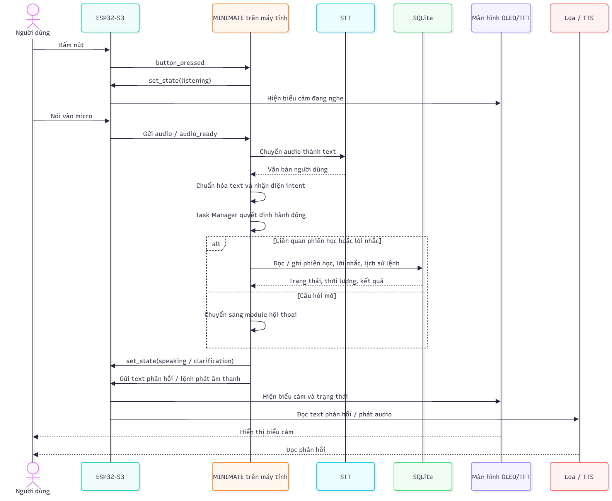

# Đặc tả kiến trúc hệ thống MINIMATE

## Phạm vi hệ thống

MINIMATE gồm phần cứng, phần mềm máy tính và giao thức trao đổi dữ liệu. Tuần 9
chạy thử phần mềm bằng terminal; micro, STT, TTS và phần cứng thật là các điểm
kết nối để tích hợp ở giai đoạn sau.

| Nhóm | Thành phần | Vai trò |
| --- | --- | --- |
| Người dùng | Lời nói, văn bản, nút bấm | Gửi yêu cầu cho MINIMATE. |
| Phần cứng | ESP32-S3, nút bấm, micro, loa, OLED/TFT | Nhận thao tác, thu/phát âm thanh, hiển thị biểu cảm. |
| Máy tính | Input, Intent Classifier, Task Manager, SQLite, Response Generator, ESP32 Adapter | Hiểu yêu cầu, điều phối tác vụ, lưu dữ liệu và giao tiếp với ESP32. |
| Tích hợp sau | STT, TTS, module hội thoại | Chuyển giọng nói thành chữ, đọc phản hồi và trả lời câu hỏi mở. |

## Sơ đồ kiến trúc hệ thống

```text
Input / STT
   ↓
Intent Classifier
   ↓
Task Manager ↔ SQLite
   ↓
Response Generator
   ↓
ESP32 Adapter
   ↓ Serial hoặc Wi-Fi (JSON)
ESP32-S3 → OLED / Loa
```
## Sơ đồ tuần tự xử lý yêu cầu

Sơ đồ dưới đây minh họa luồng xử lý khi người dùng bấm nút, nói vào micro
và MINIMATE phản hồi qua ESP32-S3.



**Hình 1.** Luồng tương tác giữa người dùng, ESP32-S3, MINIMATE trên máy tính,
SQLite, màn hình OLED/TFT và loa.

## Luồng hoạt động hệ thống

1. Nút bấm tạo event `button_pressed`; ESP32 gửi event này đến máy tính. Máy
   tính trả lệnh `set_state(listening)` về ESP32, rồi ESP32 đổi biểu cảm OLED.
2. Micro thu âm; ESP32 gửi audio đến máy tính và STT chuyển audio thành văn
   bản. Tuần 9 có thể nhập text trực tiếp ở terminal thay cho hai bước này.
3. Intent Classifier nhận ra intent. Task Manager điều phối tác vụ; nếu liên
   quan phiên học, nó đọc/ghi Session Manager và SQLite.
4. Response Generator tạo câu trả lời cùng trạng thái thiết bị như `speaking`
   hoặc `clarification`.
5. Response Generator đưa state/text cho ESP32 Adapter. Adapter gửi JSON về
   ESP32, không gửi trực tiếp đến màn hình. ESP32 mới điều khiển OLED/TFT và
   loa theo state, text hoặc lệnh âm thanh.


## Intent contract

| Intent | Dữ liệu cần có | Hành động | Trạng thái thiết bị |
| --- | --- | --- | --- |
| `greeting` | Không | Chào người dùng | `speaking` |
| `focus_session_control` | Thời lượng nếu bắt đầu | Bắt đầu hoặc hủy phiên học | `speaking`/`clarification` |
| `check_focus_session` | Không | Trả thời gian còn lại hoặc trạng thái phiên | `speaking` |
| `schedule_reminder` | Nội dung và thời điểm | Tạo lời nhắc hoặc tra cứu lịch | `speaking`/`clarification` |
| `repeat_response` | Không | Phát lại phản hồi trước | `speaking` |
| `open_question` | Nội dung câu hỏi | Chuyển sang module hội thoại | `processing` |
| `out_of_scope` | Không | Yêu cầu người dùng nói lại rõ hơn | `clarification` |

Nếu chưa có thời lượng để bắt đầu phiên học hoặc chưa đủ thời gian/nội dung để
tạo lời nhắc, Task Manager trả `clarification`. `out_of_scope` là intent thứ 7
dùng cho yêu cầu ngoài phạm vi hoặc chưa đủ rõ để xử lý.

### Action bên trong mỗi intent

Intent là nhóm yêu cầu lớn theo Figma. Task Manager dùng action để chọn việc
cụ thể cần thực hiện.

| Intent | Câu ví dụ | Action |
| --- | --- | --- |
| focus_session_control | “Bắt đầu học 25 phút” | start_session |
| focus_session_control | “Dừng học” | cancel_session |
| check_focus_session | “Còn bao lâu?” | report_remaining_time |
| check_focus_session | “Trạng thái phiên?” | report_status |
| schedule_reminder | “Nhắc tôi đi thi sau 2 ngày lúc 8 giờ” | create_reminder |
| schedule_reminder | “Xem lịch đã lưu” | list_reminders |
| out_of_scope | “Ngày mai 8 giờ” | request_clarification |

## Trạng thái

Phiên học: `idle` → `awaiting_duration` → `active` → `cancelled` hoặc `idle`.

Thiết bị: `idle`, `listening`, `processing`, `speaking`, `clarification`,
`error`.

Hai state machine tách biệt: phiên học biểu thị nghiệp vụ; trạng thái thiết bị
biểu thị những gì người dùng nhìn thấy.

## Lưu trữ cục bộ bằng SQLite

Baseline dùng SQLite, một cơ sở dữ liệu nhỏ có sẵn trong Python nên không cần
cài server. File `data/minimate.db` gồm hai bảng:

- `sessions`: chỉ lưu phiên học hiện tại — trạng thái, thời lượng, thời điểm bắt đầu.
- `commands`: lưu câu người dùng nhập, intent nhận ra, action và câu phản hồi.
- `reminders`: lưu nội dung, thời điểm và trạng thái lời nhắc.

Lưu lịch sử lệnh giúp nhóm kiểm tra baseline sai ở câu nào và sau này so sánh
với mô hình ML. Database không được đẩy lên Git vì có thể chứa dữ liệu chạy thử.

## Giao thức PC ↔ ESP32 (bản v1)

Mọi message là JSON một dòng, có `type` và `request_id`.

### ESP32 → PC

```json
{"type":"button_pressed","request_id":"r-001"}
{"type":"audio_ready","request_id":"r-002","audio_path":"capture.wav"}
{"type":"device_error","request_id":"r-003","message":"microphone_unavailable"}
```

### PC → ESP32

```json
{"type":"set_state","request_id":"r-001","state":"listening"}
{"type":"set_state","request_id":"r-002","state":"speaking"}
{"type":"speak","request_id":"r-002","text":"Bạn còn 20 phút học."}
{"type":"error","request_id":"r-003","message":"Không thể dùng microphone."}
```
